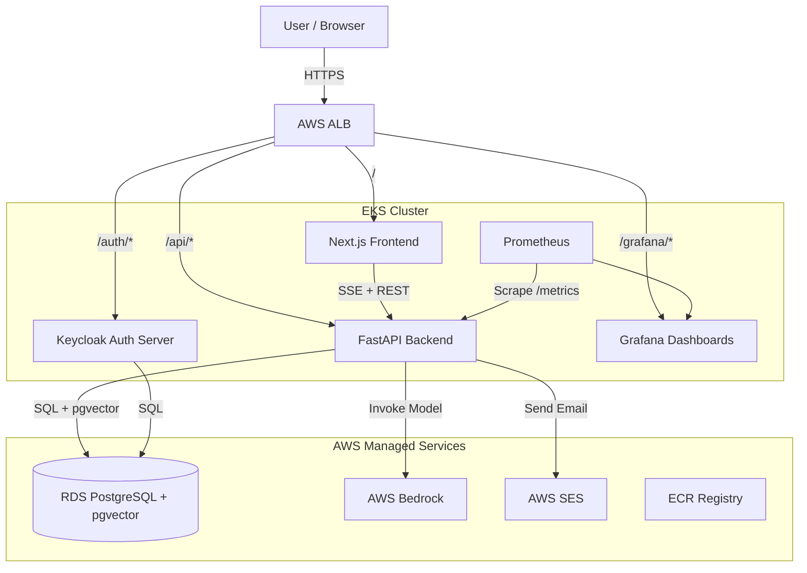
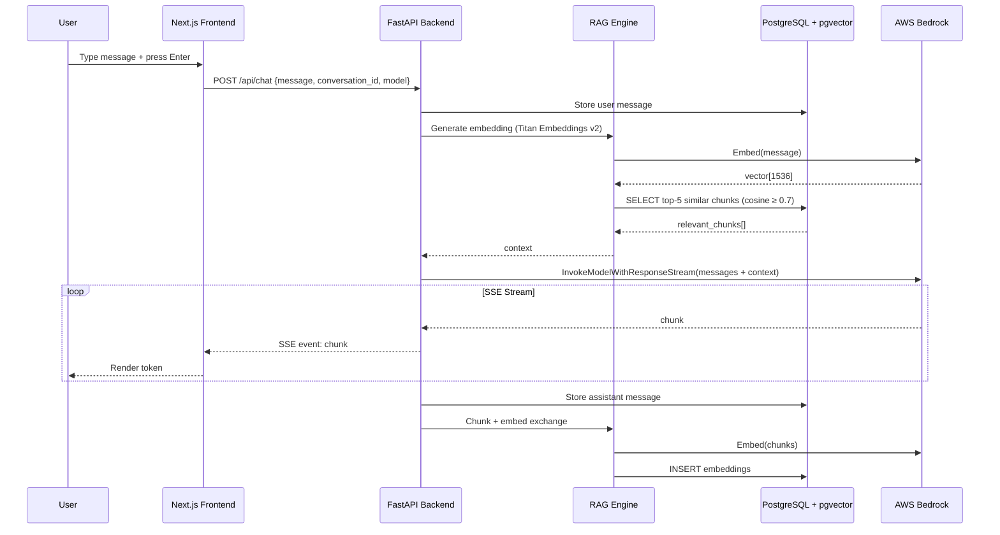
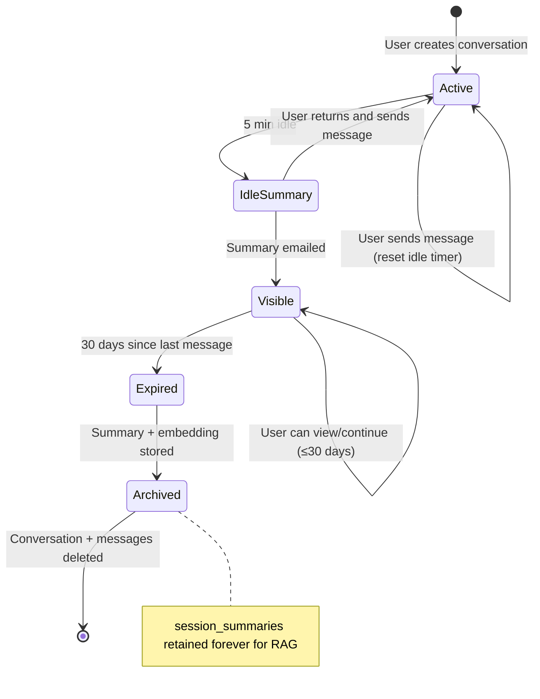

# Design Document — Claude Simulator

## Overview

Claude Simulator is a single-user AI chat platform that replicates the Claude.ai experience on self-managed AWS infrastructure. The system is composed of a Next.js frontend, a Python FastAPI backend, Keycloak for authentication, RDS PostgreSQL with pgvector for data and vector storage, and AWS Bedrock for LLM inference, embeddings, and image generation. All components run on EKS and are provisioned via Terraform and configured via Ansible.

The design prioritizes:
- Real-time streaming chat with SSE
- RAG-powered contextual memory across conversations
- Automated session lifecycle management (idle summaries, 30-day expiry)
- Production-grade DevOps (CI/CD, monitoring, IaC)

---

## Architecture

### System Context Diagram



### Request Flow — Chat Message



### Session Lifecycle Flow



---

## Components and Interfaces

### 1. Next.js Frontend (`frontend/`)

**Responsibilities:** Render chat UI, handle SSE streaming, manage auth tokens, file uploads, model selection.

**Key Pages (App Router):**

| Route | Component | Purpose |
|-------|-----------|---------|
| `/` | `ChatPage` | Main chat interface with message thread |
| `/settings` | `SettingsPage` | User memory management |
| `/login` | Redirect | Redirects to Keycloak |

**Core Components:**

```typescript
// components/ChatThread.tsx
interface ChatThreadProps {
  messages: Message[];
  isStreaming: boolean;
}

// components/MessageBubble.tsx
interface MessageBubbleProps {
  message: Message;
  isStreaming?: boolean; // show typing indicator on last assistant msg
}

// components/ChatInput.tsx
interface ChatInputProps {
  onSend: (text: string, image?: File) => void;
  disabled: boolean; // disabled while streaming
}

// components/ModelSelector.tsx
interface ModelSelectorProps {
  currentModel: 'sonnet' | 'opus';
  onChange: (model: 'sonnet' | 'opus') => void;
}

// components/ConversationSidebar.tsx
interface ConversationSidebarProps {
  conversations: ConversationSummary[];
  activeId: string | null;
  onSelect: (id: string) => void;
  onDelete: (id: string) => void;
  onNew: () => void;
}

// components/MemoryEditor.tsx
interface MemoryEditorProps {
  entries: UserMemoryEntry[];
  onSave: (entry: UserMemoryEntry) => void;
  onDelete: (id: string) => void;
}

// components/ImageUpload.tsx
interface ImageUploadProps {
  onUpload: (file: File) => void;
  maxSizeMB: number; // 5
  acceptedFormats: string[]; // ['image/png', 'image/jpeg', 'image/gif', 'image/webp']
}
```

**SSE Streaming Hook:**

```typescript
// hooks/useChat.ts
function useChat(conversationId: string) {
  // Returns: { messages, sendMessage, isStreaming, error, retry }
  // Internally: opens EventSource to /api/chat, appends chunks to current message
  // On SSE error: sets error state, exposes retry()
}
```

**Auth Integration:**

```typescript
// lib/auth.ts
// Uses next-auth or a lightweight OIDC client
// Handles: login redirect, token storage, silent refresh, Bearer header injection
// Keycloak config: realm=claude-simulator, client=claude-simulator-app, PKCE flow
```


### 2. FastAPI Backend (`backend/`)

**Responsibilities:** Business logic, Bedrock integration, RAG pipeline, session management, email, metrics.

**Project Structure:**

```
backend/
├── app/
│   ├── main.py              # FastAPI app, middleware, startup/shutdown
│   ├── api/
│   │   ├── chat.py           # POST /api/chat (streaming)
│   │   ├── conversations.py  # CRUD /api/conversations
│   │   ├── memory.py         # GET/PUT /api/memory
│   │   ├── images.py         # POST /api/images/generate
│   │   └── health.py         # GET /api/health, GET /api/metrics
│   ├── core/
│   │   ├── config.py         # Settings via pydantic-settings
│   │   ├── auth.py           # JWT validation against Keycloak JWKS
│   │   └── dependencies.py   # FastAPI dependency injection
│   ├── services/
│   │   ├── bedrock.py        # Bedrock client (chat, embeddings, image gen)
│   │   ├── rag.py            # RAG engine (embed, search, chunk, store)
│   │   ├── session.py        # Session manager (idle detection, expiry job)
│   │   └── email.py          # SES email sender
│   ├── models/
│   │   ├── database.py       # SQLAlchemy async engine + session
│   │   ├── schemas.py        # Pydantic request/response models
│   │   └── orm.py            # SQLAlchemy ORM models
│   └── utils/
│       ├── chunking.py       # Text chunking (≤500 tokens per chunk)
│       └── streaming.py      # SSE response helpers
├── tests/
├── Dockerfile
└── requirements.txt
```

**API Endpoints:**

```python
# api/chat.py
@router.post("/api/chat")
async def chat(
    request: ChatRequest,       # {message: str, conversation_id: str, model: str, image?: base64}
    user: User = Depends(get_current_user),
) -> StreamingResponse:
    """
    1. Store user message in DB
    2. Generate embedding of user message
    3. RAG: query pgvector for top-5 similar chunks (cosine ≥ 0.7)
    4. Build prompt with RAG context + conversation history
    5. Stream Bedrock response via SSE
    6. On stream complete: store assistant message, chunk+embed exchange
    """

# api/conversations.py
@router.post("/api/conversations")
async def create_conversation(user: User = Depends(get_current_user)) -> ConversationResponse:
    """Create new conversation, return id."""

@router.get("/api/conversations")
async def list_conversations(user: User = Depends(get_current_user)) -> list[ConversationSummary]:
    """List conversations within 30-day window, ordered by updated_at DESC."""

@router.get("/api/conversations/{conversation_id}")
async def get_conversation(conversation_id: str, user: User = Depends(get_current_user)) -> ConversationDetail:
    """Get full message history for a conversation."""

@router.delete("/api/conversations/{conversation_id}")
async def delete_conversation(conversation_id: str, user: User = Depends(get_current_user)) -> None:
    """Delete conversation, messages, and associated embeddings."""

# api/memory.py
@router.get("/api/memory")
async def get_memory(user: User = Depends(get_current_user)) -> list[UserMemoryEntry]:
    """Get all user memory entries."""

@router.post("/api/memory")
async def create_memory(entry: MemoryCreateRequest, user: User = Depends(get_current_user)) -> UserMemoryEntry:
    """Create memory entry with embedding."""

@router.put("/api/memory/{entry_id}")
async def update_memory(entry_id: str, entry: MemoryUpdateRequest, user: User = Depends(get_current_user)) -> UserMemoryEntry:
    """Update memory entry, regenerate embedding."""

@router.delete("/api/memory/{entry_id}")
async def delete_memory(entry_id: str, user: User = Depends(get_current_user)) -> None:
    """Delete memory entry and its embedding."""

# api/images.py
@router.post("/api/images/generate")
async def generate_image(request: ImageGenRequest, user: User = Depends(get_current_user)) -> ImageGenResponse:
    """Generate image via Bedrock Titan Image Generator."""

# api/health.py
@router.get("/api/health")
async def health_check() -> HealthResponse:
    """Check DB connectivity and Bedrock availability. Returns 200 or 503."""
```

**Key Service Interfaces:**

```python
# services/bedrock.py
class BedrockService:
    async def stream_chat(
        self, messages: list[dict], model: str, system_prompt: str
    ) -> AsyncGenerator[str, None]:
        """Stream chat completion from Bedrock. Yields text chunks."""

    async def generate_embedding(self, text: str) -> list[float]:
        """Generate 1536-dim embedding via Titan Embeddings v2."""

    async def generate_image(self, prompt: str) -> bytes:
        """Generate image via Titan Image Generator. Returns PNG bytes."""

    async def generate_summary(self, messages: list[dict]) -> str:
        """Generate conversation summary using Sonnet."""

# services/rag.py
class RAGService:
    async def retrieve_context(self, query_embedding: list[float], top_k: int = 5, threshold: float = 0.7) -> list[RAGResult]:
        """Query pgvector across embeddings, user_memory, session_summaries. Returns chunks with similarity ≥ threshold."""

    async def store_exchange(self, conversation_id: str, user_text: str, assistant_text: str) -> None:
        """Chunk the exchange (≤500 tokens), embed each chunk, store in embeddings table."""

# services/session.py
class SessionManager:
    async def track_activity(self, conversation_id: str) -> None:
        """Update last activity timestamp for conversation."""

    async def check_idle_conversations(self) -> list[str]:
        """Find conversations idle for ≥5 minutes. Called periodically."""

    async def generate_and_email_summary(self, conversation_id: str) -> None:
        """Generate summary via Bedrock, store it, send via SES."""

    async def run_expiry_job(self) -> None:
        """Daily job: find conversations >30 days old, archive to session_summaries, delete originals."""

# services/email.py
class EmailService:
    async def send_session_summary(self, summary: str, conversation_title: str) -> None:
        """Send HTML email via SES. Retries up to 3 times with exponential backoff."""
```

**Auth Middleware:**

```python
# core/auth.py
class JWTValidator:
    """Validates JWT access tokens against Keycloak JWKS endpoint.
    Caches JWKS keys. Returns 401 on invalid/expired tokens."""

    async def validate_token(self, token: str) -> dict:
        """Decode and validate JWT. Returns claims dict or raises HTTPException(401)."""

# core/dependencies.py
async def get_current_user(authorization: str = Header(...)) -> User:
    """FastAPI dependency. Extracts Bearer token, validates via JWTValidator."""
```

### 3. Keycloak Auth Server

**Configuration (managed by Ansible):**
- Realm: `claude-simulator`
- Client: `claude-simulator-app` (public client, PKCE flow)
- Single user account
- Brute-force protection: lock after 5 failed attempts for 15 minutes
- Token lifetimes: access token 5 min, refresh token 30 min
- Deployed via `bitnami/keycloak` Helm chart in `auth` namespace
- Uses RDS PostgreSQL as its backing database (separate database from app)

### 4. Monitoring Stack

**Prometheus:**
- Deployed via `kube-prometheus-stack` Helm chart in `monitoring` namespace
- Scrapes `/metrics` from FastAPI backend (prometheus-fastapi-instrumentator)
- Scrapes K8s node metrics via node-exporter
- Scrapes kube-state-metrics for pod/deployment status

**Grafana Dashboards:**
- Backend API Metrics: request rate, latency p50/p95/p99, error rate, active SSE connections
- K8s Cluster Health: node CPU/memory, pod restarts, deployment status
- RDS Performance: connections, query latency, storage usage
- Bedrock Usage: invocation count, latency, error rate (custom metrics from backend)

### 5. Infrastructure Components

**Terraform Modules:**

| Module | Resources |
|--------|-----------|
| `networking` | VPC, public/private subnets, NAT gateway, route tables |
| `eks` | EKS cluster, managed node group (t3.medium, 2-4 nodes), OIDC provider |
| `rds` | PostgreSQL instance (db.t3.micro), subnet group, security group, pgvector extension |
| `ecr` | Frontend + backend repositories, lifecycle policies |
| `alb` | ALB, target groups, listeners, path-based routing rules |
| `iam` | IRSA roles (bedrock, ses, ecr), CI/CD OIDC role, EKS node role |
| `ses` | Email identity verification |
| `state` | S3 bucket + DynamoDB table for Terraform state |

**Ansible Roles:**

| Role | Tasks |
|------|-------|
| `helm-repos` | Add bitnami, prometheus-community Helm repos |
| `monitoring` | Deploy kube-prometheus-stack, configure Grafana dashboards |
| `keycloak` | Deploy Keycloak Helm chart, configure realm/client/user |
| `application` | Deploy frontend + backend Helm charts, configure ingress |
| `verify` | Health check all services |

---

## Data Models

### Database Schema (PostgreSQL + pgvector)

```sql
-- Enable pgvector extension
CREATE EXTENSION IF NOT EXISTS vector;

-- Conversations
CREATE TABLE conversations (
    id UUID PRIMARY KEY DEFAULT gen_random_uuid(),
    title VARCHAR(255),
    created_at TIMESTAMP WITH TIME ZONE DEFAULT NOW(),
    updated_at TIMESTAMP WITH TIME ZONE DEFAULT NOW(),
    last_message_at TIMESTAMP WITH TIME ZONE DEFAULT NOW()
);

CREATE INDEX idx_conversations_updated ON conversations(updated_at DESC);
CREATE INDEX idx_conversations_last_message ON conversations(last_message_at);

-- Messages
CREATE TABLE messages (
    id UUID PRIMARY KEY DEFAULT gen_random_uuid(),
    conversation_id UUID NOT NULL REFERENCES conversations(id) ON DELETE CASCADE,
    role VARCHAR(20) NOT NULL CHECK (role IN ('user', 'assistant')),
    content TEXT NOT NULL,
    has_image BOOLEAN DEFAULT FALSE,
    image_data TEXT, -- base64 encoded, nullable
    created_at TIMESTAMP WITH TIME ZONE DEFAULT NOW()
);

CREATE INDEX idx_messages_conversation ON messages(conversation_id, created_at);

-- Vector embeddings for RAG (conversation chunks)
CREATE TABLE embeddings (
    id UUID PRIMARY KEY DEFAULT gen_random_uuid(),
    conversation_id UUID NOT NULL REFERENCES conversations(id) ON DELETE CASCADE,
    chunk_text TEXT NOT NULL,
    embedding vector(1536) NOT NULL,
    created_at TIMESTAMP WITH TIME ZONE DEFAULT NOW()
);

CREATE INDEX idx_embeddings_vector ON embeddings USING ivfflat (embedding vector_cosine_ops) WITH (lists = 100);

-- User memory (manually managed facts/preferences)
CREATE TABLE user_memory (
    id UUID PRIMARY KEY DEFAULT gen_random_uuid(),
    content TEXT NOT NULL,
    embedding vector(1536) NOT NULL,
    created_at TIMESTAMP WITH TIME ZONE DEFAULT NOW(),
    updated_at TIMESTAMP WITH TIME ZONE DEFAULT NOW()
);

CREATE INDEX idx_user_memory_vector ON user_memory USING ivfflat (embedding vector_cosine_ops) WITH (lists = 20);

-- Session summaries (long-term memory, retained indefinitely)
CREATE TABLE session_summaries (
    id UUID PRIMARY KEY DEFAULT gen_random_uuid(),
    conversation_id UUID, -- nullable, original conversation may be deleted
    summary_text TEXT NOT NULL,
    embedding vector(1536) NOT NULL,
    created_at TIMESTAMP WITH TIME ZONE DEFAULT NOW()
);

CREATE INDEX idx_session_summaries_vector ON session_summaries USING ivfflat (embedding vector_cosine_ops) WITH (lists = 50);
```

### Pydantic Models (Request/Response)

```python
from pydantic import BaseModel, Field
from datetime import datetime
from enum import Enum

class ModelChoice(str, Enum):
    SONNET = "sonnet"
    OPUS = "opus"

# --- Chat ---
class ChatRequest(BaseModel):
    message: str = Field(..., min_length=1)
    conversation_id: str
    model: ModelChoice = ModelChoice.SONNET
    image: str | None = None  # base64 encoded

# --- Conversations ---
class ConversationSummary(BaseModel):
    id: str
    title: str | None
    updated_at: datetime

class ConversationDetail(BaseModel):
    id: str
    title: str | None
    messages: list["MessageResponse"]

class MessageResponse(BaseModel):
    id: str
    role: str
    content: str
    has_image: bool
    created_at: datetime

# --- Memory ---
class MemoryCreateRequest(BaseModel):
    content: str = Field(..., min_length=1)

class MemoryUpdateRequest(BaseModel):
    content: str = Field(..., min_length=1)

class UserMemoryEntry(BaseModel):
    id: str
    content: str
    created_at: datetime
    updated_at: datetime

# --- Images ---
class ImageGenRequest(BaseModel):
    prompt: str = Field(..., min_length=1)

class ImageGenResponse(BaseModel):
    image_data: str  # base64 PNG

# --- Health ---
class HealthResponse(BaseModel):
    status: str  # "healthy" or "unhealthy"
    database: bool
    bedrock: bool
```

### SQLAlchemy ORM Models

```python
from sqlalchemy import Column, String, Text, Boolean, DateTime, ForeignKey, CheckConstraint
from sqlalchemy.dialects.postgresql import UUID
from pgvector.sqlalchemy import Vector
from sqlalchemy.orm import relationship, DeclarativeBase
import uuid
from datetime import datetime, timezone

class Base(DeclarativeBase):
    pass

class Conversation(Base):
    __tablename__ = "conversations"
    id = Column(UUID(as_uuid=True), primary_key=True, default=uuid.uuid4)
    title = Column(String(255), nullable=True)
    created_at = Column(DateTime(timezone=True), default=lambda: datetime.now(timezone.utc))
    updated_at = Column(DateTime(timezone=True), default=lambda: datetime.now(timezone.utc), onupdate=lambda: datetime.now(timezone.utc))
    last_message_at = Column(DateTime(timezone=True), default=lambda: datetime.now(timezone.utc))
    messages = relationship("Message", back_populates="conversation", cascade="all, delete-orphan")
    embeddings = relationship("Embedding", back_populates="conversation", cascade="all, delete-orphan")

class Message(Base):
    __tablename__ = "messages"
    id = Column(UUID(as_uuid=True), primary_key=True, default=uuid.uuid4)
    conversation_id = Column(UUID(as_uuid=True), ForeignKey("conversations.id", ondelete="CASCADE"), nullable=False)
    role = Column(String(20), CheckConstraint("role IN ('user', 'assistant')"), nullable=False)
    content = Column(Text, nullable=False)
    has_image = Column(Boolean, default=False)
    image_data = Column(Text, nullable=True)
    created_at = Column(DateTime(timezone=True), default=lambda: datetime.now(timezone.utc))
    conversation = relationship("Conversation", back_populates="messages")

class Embedding(Base):
    __tablename__ = "embeddings"
    id = Column(UUID(as_uuid=True), primary_key=True, default=uuid.uuid4)
    conversation_id = Column(UUID(as_uuid=True), ForeignKey("conversations.id", ondelete="CASCADE"), nullable=False)
    chunk_text = Column(Text, nullable=False)
    embedding = Column(Vector(1536), nullable=False)
    created_at = Column(DateTime(timezone=True), default=lambda: datetime.now(timezone.utc))
    conversation = relationship("Conversation", back_populates="embeddings")

class UserMemory(Base):
    __tablename__ = "user_memory"
    id = Column(UUID(as_uuid=True), primary_key=True, default=uuid.uuid4)
    content = Column(Text, nullable=False)
    embedding = Column(Vector(1536), nullable=False)
    created_at = Column(DateTime(timezone=True), default=lambda: datetime.now(timezone.utc))
    updated_at = Column(DateTime(timezone=True), default=lambda: datetime.now(timezone.utc), onupdate=lambda: datetime.now(timezone.utc))

class SessionSummary(Base):
    __tablename__ = "session_summaries"
    id = Column(UUID(as_uuid=True), primary_key=True, default=uuid.uuid4)
    conversation_id = Column(UUID(as_uuid=True), nullable=True)
    summary_text = Column(Text, nullable=False)
    embedding = Column(Vector(1536), nullable=False)
    created_at = Column(DateTime(timezone=True), default=lambda: datetime.now(timezone.utc))
```

---

## Correctness Properties

*A property is a characteristic or behavior that should hold true across all valid executions of a system — essentially, a formal statement about what the system should do. Properties serve as the bridge between human-readable specifications and machine-verifiable correctness guarantees.*

### Property 1: Prompt includes conversation history and RAG context

*For any* user message sent within a conversation, the prompt payload sent to Bedrock SHALL contain the conversation's message history and any RAG context retrieved from the Memory_Store. If RAG returns no results above the similarity threshold, the prompt SHALL still contain the conversation history and proceed without RAG context.

**Validates: Requirements 1.1, 4.3, 4.6**

### Property 2: Chunk assembly produces correct message

*For any* sequence of SSE text chunks received by the frontend, concatenating them in order SHALL produce the complete assistant response text identical to what Bedrock generated.

**Validates: Requirements 1.3**

### Property 3: Message persistence round-trip

*For any* user message and its corresponding assistant response stored in the database, retrieving the conversation's message history SHALL return those messages with matching conversation_id, role, content, and chronological ordering.

**Validates: Requirements 1.5, 3.3**

### Property 4: Bedrock errors produce structured error responses

*For any* error returned by the Bedrock service (chat inference or image generation), the Backend_API SHALL return a response containing an error code and a human-readable description string, never an unstructured or empty error.

**Validates: Requirements 1.6, 9.4**

### Property 5: Model selection propagated in requests

*For any* model selection made in the Chat_Interface (sonnet or opus), the next chat request sent to the Backend_API SHALL include the corresponding model identifier in the request payload.

**Validates: Requirements 2.2**

### Property 6: Model identifier maps to correct Bedrock model

*For any* valid model identifier received by the Backend_API ("sonnet" or "opus"), the Bedrock invocation SHALL use the corresponding model ID ("anthropic.claude-sonnet-4-20250514" for sonnet, "anthropic.claude-opus" for opus).

**Validates: Requirements 2.3, 2.5**

### Property 7: Conversation listing is ordered by recency

*For any* set of conversations returned by the list endpoint, they SHALL be ordered by `updated_at` descending, such that for every adjacent pair (i, i+1), `conversations[i].updated_at >= conversations[i+1].updated_at`.

**Validates: Requirements 3.2**

### Property 8: Conversation cascade deletion

*For any* conversation that is deleted (either by user action or by the expiry job), all associated messages and chunk embeddings SHALL be removed from the database, and querying for those records SHALL return empty results.

**Validates: Requirements 3.4, 7.4**

### Property 9: Auto-generated conversation title

*For any* new conversation that receives its first user message, the conversation's title field SHALL be non-null and non-empty after the message is processed.

**Validates: Requirements 3.5**

### Property 10: RAG retrieval constraints

*For any* query embedding, the RAG_Engine SHALL return at most 5 results, all with cosine similarity ≥ 0.7, ordered by similarity descending. The search SHALL span the embeddings, user_memory, and session_summaries tables.

**Validates: Requirements 4.2, 4.5, 5.5**

### Property 11: Text chunking produces segments ≤ 500 tokens

*For any* text input to the chunking function, every output chunk SHALL contain 500 tokens or fewer, and the concatenation of all chunks SHALL be equivalent to the original text (no content lost or duplicated).

**Validates: Requirements 4.4**

### Property 12: User memory CRUD round-trip

*For any* user memory entry that is created or updated, retrieving it from the database SHALL return the same text content, and the stored embedding SHALL be a valid 1536-dimensional vector corresponding to that text.

**Validates: Requirements 5.2, 5.3**

### Property 13: User memory deletion

*For any* user memory entry that is deleted, querying the user_memory table for that entry's ID SHALL return no results.

**Validates: Requirements 5.4**

### Property 14: Idle timer tracking

*For any* message sent in a conversation, the conversation's `last_message_at` timestamp SHALL be updated to a value within 1 second of the current server time, effectively resetting the idle timer.

**Validates: Requirements 6.1, 6.5**

### Property 15: Idle summary generation trigger

*For any* conversation where the elapsed time since `last_message_at` is ≥ 5 minutes, the Session_Manager's idle check SHALL identify that conversation as requiring a summary.

**Validates: Requirements 6.2**

### Property 16: Email retry with exponential backoff

*For any* email send failure, the Email_Service SHALL retry up to 3 times, with each retry delay being greater than the previous delay (exponential backoff pattern). After 3 failures, the operation SHALL stop retrying and report failure.

**Validates: Requirements 6.4**

### Property 17: Summary persistence regardless of email outcome

*For any* generated session summary, the summary text and its embedding SHALL be stored in the session_summaries table regardless of whether the email send succeeds or fails.

**Validates: Requirements 6.6**

### Property 18: 30-day conversation filter

*For any* set of conversations in the database, the list endpoint and the expiry job SHALL correctly partition them: conversations with `last_message_at` within 30 days are visible in the UI, and those older than 30 days are identified for expiry.

**Validates: Requirements 7.1, 7.6**

### Property 19: Expiry archival preserves summaries indefinitely

*For any* expired conversation, after the expiry job runs, a session_summary record SHALL exist for that conversation, and the expiry job SHALL NOT delete any records from the session_summaries table.

**Validates: Requirements 7.2, 7.3, 7.5**

### Property 20: Image upload validation

*For any* file submitted for upload, the validation function SHALL accept it if and only if the file format is one of (PNG, JPEG, GIF, WebP) AND the file size is ≤ 5MB. All other files SHALL be rejected with a validation error.

**Validates: Requirements 8.1, 8.5**

### Property 21: Image base64 encoding for Bedrock

*For any* uploaded image, the Backend_API SHALL encode it as a valid base64 string and include it in the Bedrock request payload as a multimodal message component.

**Validates: Requirements 8.2**

### Property 22: Image persistence with messages

*For any* message that includes an uploaded or generated image, the corresponding message record SHALL have `has_image = true` and a non-null `image_data` field containing the image data.

**Validates: Requirements 8.6, 9.5**

### Property 23: JWT validation on every request

*For any* request to a protected Backend_API endpoint, the API SHALL validate the JWT access token against the Keycloak JWKS endpoint. Valid tokens SHALL grant access; expired or invalid tokens SHALL result in a 401 response.

**Validates: Requirements 10.4, 10.5**

### Property 24: Metrics endpoint produces valid Prometheus format

*For any* GET request to the /metrics endpoint, the response SHALL contain valid Prometheus exposition format text including at minimum: `http_requests_total`, `http_request_duration_seconds`, and error rate counters.

**Validates: Requirements 11.1**

---

## Error Handling

### Backend API Error Strategy

| Error Source | Handling | Response |
|---|---|---|
| Bedrock inference error | Catch `ClientError`, log, return structured error | `{"error_code": "BEDROCK_ERROR", "message": "..."}` with HTTP 502 |
| Bedrock timeout | Catch `ReadTimeoutError`, log, return error | `{"error_code": "BEDROCK_TIMEOUT", "message": "..."}` with HTTP 504 |
| Bedrock image gen error | Catch `ClientError`, log, return error | `{"error_code": "IMAGE_GEN_ERROR", "message": "..."}` with HTTP 502 |
| RDS connection failure | Catch `OperationalError`, health check fails | `/health` returns 503, K8s restarts pod |
| JWT validation failure | Catch `JWTError`, return 401 | `{"detail": "Invalid or expired token"}` with HTTP 401 |
| Invalid request body | Pydantic validation | `{"detail": [...]}` with HTTP 422 |
| File too large / wrong format | Validation in upload handler | `{"error_code": "INVALID_FILE", "message": "..."}` with HTTP 400 |
| SES email failure | Retry 3x with exponential backoff, log | Summary still stored; email failure logged |
| RAG query failure | Catch, log, proceed without RAG context | Chat continues without augmented context |
| SSE connection drop | Frontend detects EventSource error | Show error notification + retry button |

### Error Response Schema

```python
class ErrorResponse(BaseModel):
    error_code: str
    message: str
    details: dict | None = None
```

### Retry Policies

| Operation | Max Retries | Backoff | Notes |
|---|---|---|---|
| SES email send | 3 | Exponential (1s, 2s, 4s) | Store summary regardless |
| Bedrock invocation | 0 | N/A | Fail fast, let user retry |
| RDS query | 1 | 500ms | Connection pool handles most issues |
| Keycloak JWKS fetch | 2 | 1s, 2s | Cache keys to reduce calls |

### Health Check Logic

```python
async def health_check() -> HealthResponse:
    db_ok = await check_db_connection()      # Simple SELECT 1
    bedrock_ok = await check_bedrock_access() # Lightweight API call
    status = "healthy" if (db_ok and bedrock_ok) else "unhealthy"
    return HealthResponse(status=status, database=db_ok, bedrock=bedrock_ok)
    # Returns 200 if healthy, 503 if unhealthy
```

---

## Testing Strategy

### Dual Testing Approach

This project uses both unit tests and property-based tests for comprehensive coverage:

- **Unit tests** (pytest + jest): Verify specific examples, edge cases, integration points, and error conditions
- **Property-based tests** (Hypothesis for Python, fast-check for TypeScript): Verify universal properties across randomized inputs

Both are complementary — unit tests catch concrete bugs with known inputs, property tests verify general correctness across the input space.

### Property-Based Testing Configuration

- **Python backend**: Use [Hypothesis](https://hypothesis.readthedocs.io/) library
- **TypeScript frontend**: Use [fast-check](https://fast-check.dev/) library
- Each property test runs a minimum of **100 iterations**
- Each property test is tagged with a comment referencing the design property:
  ```python
  # Feature: claude-simulator, Property 11: Text chunking produces segments ≤ 500 tokens
  ```
- Each correctness property is implemented by a **single** property-based test

### Backend Tests (pytest + Hypothesis)

**Unit Tests:**
- API endpoint tests with mocked services (Bedrock, RDS, SES)
- JWT validation with valid, expired, and malformed tokens
- Health check with healthy and unhealthy dependencies
- Conversation CRUD operations
- Memory CRUD operations
- Error response formatting for each error type
- SSE streaming response format

**Property Tests (Hypothesis):**
- Property 1: Prompt construction includes history + RAG context
- Property 3: Message persistence round-trip
- Property 4: Bedrock errors → structured error responses
- Property 6: Model identifier → Bedrock model mapping
- Property 7: Conversation listing ordering
- Property 8: Cascade deletion completeness
- Property 10: RAG retrieval constraints (top-5, similarity ≥ 0.7)
- Property 11: Text chunking ≤ 500 tokens with no content loss
- Property 12: User memory CRUD round-trip
- Property 13: User memory deletion
- Property 14: Idle timer tracking
- Property 15: Idle summary trigger at 5 minutes
- Property 16: Email retry with exponential backoff
- Property 17: Summary persistence regardless of email
- Property 18: 30-day conversation filter
- Property 19: Expiry archival preserves summaries
- Property 20: Image upload validation
- Property 22: Image persistence with messages
- Property 23: JWT validation (valid vs invalid tokens)
- Property 24: Metrics endpoint format

**Example Hypothesis test structure:**
```python
from hypothesis import given, strategies as st, settings

# Feature: claude-simulator, Property 11: Text chunking produces segments ≤ 500 tokens
@settings(max_examples=100)
@given(text=st.text(min_size=1, max_size=10000))
def test_chunking_segments_within_limit(text: str):
    chunks = chunk_text(text, max_tokens=500)
    for chunk in chunks:
        assert count_tokens(chunk) <= 500
    assert "".join(chunks) == text
```

### Frontend Tests (Jest + fast-check)

**Unit Tests:**
- Component rendering tests (ChatThread, MessageBubble, ModelSelector, etc.)
- SSE chunk assembly
- Auth token injection in requests
- File upload validation
- Model selection state management

**Property Tests (fast-check):**
- Property 2: Chunk assembly produces correct message
- Property 5: Model selection propagated in requests
- Property 20: Image upload validation (frontend validation mirror)

**Example fast-check test structure:**
```typescript
import fc from 'fast-check';

// Feature: claude-simulator, Property 2: Chunk assembly produces correct message
test('chunk assembly produces correct message', () => {
  fc.assert(
    fc.property(
      fc.array(fc.string({ minLength: 1 }), { minLength: 1 }),
      (chunks: string[]) => {
        const assembled = assembleChunks(chunks);
        expect(assembled).toBe(chunks.join(''));
      }
    ),
    { numRuns: 100 }
  );
});
```

### Integration Tests

- End-to-end chat flow: send message → receive streaming response → verify persistence
- RAG pipeline: store embedding → query similar → verify retrieval
- Session lifecycle: create → idle → summary → expiry → verify archival
- Auth flow: login → get token → make authenticated request → verify access

### Test Infrastructure

- Backend: `pytest`, `pytest-asyncio`, `hypothesis`, `httpx` (async test client), `unittest.mock`
- Frontend: `jest`, `@testing-library/react`, `fast-check`, `msw` (mock service worker for API mocking)
- CI: All tests run in GitHub Actions on push to main (Requirement 14.1)
